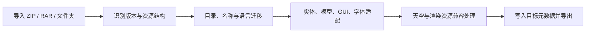

<div align="center">
  
  <h1>Fast Pack</h1>
  <p><strong>Minecraft Java 材质包转换工具</strong></p>
  <p>纯 Rust · 多版本自动适配 · 本地处理 · GPL v3 开源</p>

  <a href="https://github.com/LongCold-ColdEternity-Team/Fast-Pack/releases/latest"></a>
  <a href="LICENSE"></a>
  <a href="https://github.com/LongCold-ColdEternity-Team/Fast-Pack/stargazers"></a>
</div>

Fast Pack 是面向 Minecraft Java Edition 的材质包版本转换工具，由 **ColdEternity Team、Long_Cold、Wind_** 开发。导入 ZIP 或已解压的材质包，选择目标版本后，程序自动处理资源目录、纹理命名、实体 UV、模型与方块状态、GUI 图集、字体、天空以及材质包内的渲染资源兼容规则。

**原始仓库：[LongCold-ColdEternity-Team/Fast-Pack](https://github.com/LongCold-ColdEternity-Team/Fast-Pack)**  
**下载成品：[GitHub Releases](https://github.com/LongCold-ColdEternity-Team/Fast-Pack/releases/latest)**

This project uses SignPath Foundation for code signing of Windows executable releases.

## 项目特点

- **独立制作覆盖包。** 顶部切换“材质包转换 / 覆盖包制作”。无需导入原包，选择任意支持的游戏版本，单独制作附魔光效、准星、鱼线、方块选中边框和物品设置。图标可导入 PNG / JPG；名称和简介提供快捷色块、加粗、斜体、下划线、删除线、随机字符和实时预览。直接点击修改整段，选字后只改局部，也支持原生 `§` 格式代码。名称使用游戏支持的 16 色，新版简介支持自定义 RGB。草稿保存在 C 盘用户配置；输出支持 ZIP 或文件夹，游戏内放在其他材质包上方使用。
- **完整正式版本列表。** 从 1.7.10 起逐个列出全部 76 个已发布正式版本，不省略补丁版本；另含 26.4 的三个已发布快照和 `26.4` 快照别名，共 80 个可选标签。支持升级、降级和同版本整理，目标规则自动执行。
- **按渲染代际处理资源。** 识别材质包中的核心与后处理着色器，优先匹配包内的目标版本变体；对已识别的引用规则进行处理，跨代且无可确认兼容变体的覆盖自动备份回退。程序会明确记录原效果未被保留的情况。
- **天空资源跨格式迁移。** 自动处理 MCPatcher、OptiFine 的目录与 `source` 引用，重排六面贴图朝向，并支持已识别的静态 FSB / Nuit 天空结构与反向转换。旧包转到新版本时，天空资源也参与转换。
- **实体贴图按像素重建。** 箱子 UV 重排、双箱左右拆分、旧船到新船的纹理映射、旗帜和盾牌透明掩码转换都由程序执行，支持标准布局的高清比例。
- **GUI 与字体一起迁移。** 根据 88 条精灵配方拆分或合并 GUI 图集，生成窄版效果列表，适配游戏模式槽位与附魔光效，处理旧 Unicode 字体页。
- **自定义附魔闪烁颜色。** 在“更多转换选项”中选择白色、经典紫、冰蓝、薄荷绿、金色、粉色、红色，也可以输入任意 HEX 色值或拖动方形调色卡。调色面板采用方形饱和度 / 明暗卡与竖向色相条，提供流动光效示意。颜色自动保存，每次启动和转换结束后取消自定义勾选，需要使用时手动启用；跨版本转换自动处理旧版渲染器的紫色染色，保留原图案、透明度与动画元数据。
- **旧版工具与装备保留材质。** 对照官方资源补齐 227 个旧版物品纹理名称，递归处理嵌套贴图与模型引用，区分方块和物品的映射。支持木质工具、弓、鱼竿、染料、药水、唱片等旧名称，以及弓 / 鱼竿状态和时钟 / 罗盘帧。
- **旧工具轮廓与厚度。** 旧包转到 1.9+ 时，识别生成式物品贴图里大面积 alpha 为 1–2 的近透明背景，将其恢复为真正透明，让新版沿工具实际轮廓生成侧面，避免只剩正反两张薄片。保留可见像素、RGB、动画元数据和已有自定义立体模型，不改写手持角度与缩放规则。
- **立体床图标与方块手持大小。** 识别继承旧 `block/bed_inventory` 的立体床物品，在背包视角过大、偏移或只显示侧面时，按模型实际边界居中并缩放，改用能看清床面的立体视角；保留床的几何、UV、实体贴图和手持姿态。对铁砧等自定义方块补齐缺失的原生父模型继承，使其正确取得目标版本的手持缩放、光照和物品框姿态，保留作者已有的显式显示参数。
- **减少转换中的重复工作。** 官方模型参考按目标格式在进程内复用；每个包只扫描一次模型自检所需的贴图清单，缓存有效的模型继承结果，并在修复改变模型时清空对应缓存。ZIP 导出使用固定大小的写入缓冲，在缓冲内完成小文件头的校验和回填；文件夹输出的自动导入共用相同打包逻辑。
- **无损减小程序和输出包。** 发布构建保留 LTO、单代码生成单元和符号剥离，并针对项目代码优化体积。普通源码构建默认压缩三组大型内置参考数据；发布版保留不同数据布局的构建入口；GUI 与 CLI 发布版采用 UPX 压缩，保留 GPU 渲染与全部内置资源；ZIP 便携包继续压缩保存。所有 UI、版本数据和转换修复完整保留。材质包 ZIP 自动使用 DEFLATE 9 级压缩，保留图片、模型、音频、动画及原始备份的内容和分辨率；压缩级别提高可能增加导出耗时。
- **自动补齐同风格下界合金套装。** 目标版本为 1.16+ 时，自动为原包缺失的下界合金剑、斧、镐、锹、锄、头盔、胸甲、护腿和靴子制作材质，并补穿戴贴图。优先采用原包同类钻石装备，缺失时依次采用可用的其他材质；保留像素轮廓、短剑长度、分辨率、透明度、阴影层次和动画，按原版下界合金材质分开处理暗红底色、紫色金属包边、银紫刃口高光与暗红柄部细节，依据原图轮廓增加边缘层次。模型继承、立体几何、UV、手持大小、旋转及自定义状态变体同步适配，1.20+ 盔甲纹饰和 1.21.4+ 物品定义也会生成。已有下界合金贴图、模型或物品定义优先保留。“更多转换选项”中“减少动态效果”右侧提供“自动制作下界合金材质”勾选框，默认勾选；取消勾选后仅本次停止补齐缺失的下界合金剑、工具和盔甲材质，保留原包已有资源。每次转换结束以及重新打开软件时自动恢复勾选，不保存取消状态。原包未提供某类装备参考时沿用目标原版资源。
- **天空贴图自动共用。** 天空层按图片内容共用纹理，格式和尺寸已经匹配时直接引用原图，内部天空缓存只保存资源路径；同一张图用于多个时段时不再重复保存。需要六面重排或尺寸对齐时只生成一次无损 PNG。再次转换旧版 Fast Pack 导出的包时，自动整理重复缓存和已经无引用的程序生成天空纹理，保留实际使用的资源、自定义条件和跨版本还原数据。
- **天空图尺寸自动对齐。** 对明确使用 3×2 六面布局、因缩放或像素取整而略偏比例的天空图，按六个独立面重采样到相同的正方形尺寸，自动处理 2560×1706、3500×2334、3015×2048、2210×1535 等图集。完整保留每面的覆盖范围，避免整图缩放造成相邻面串色；标准尺寸的图集保持像素不变，预览与 OptiFine / FabricSkyBoxes / Nuit 转换使用同一套规则。
- **跨协议物品外观自动还原。** 除已临时停用的 1.20.1 适配外，选择 1.16.2+ 的目标客户端时，自动补齐可表达的新版物品模型与贴图，以及 ViaBackwards 的物品识别规则。1.20.1 可识别重锤、风弹、旋风棒、沉重核心、试炼钥匙、狼铠、新版铜块和凝灰岩等；普通承载物品继续使用原包模型。原包已提供的新物品资源优先，缺失时使用官方参考资源。新版服务器可通过数字 `CustomModelData` 让旧原版客户端直接选模型；旧服务器可使用自动生成的 OptiFine CIT / Chime 标签规则。1.21.4+ 同时生成字符串选择和数字规则。适配仅涉及物品栏与手持外观，不改变服务端玩法，也不替换放置后的方块或实体渲染。
- **只有贴图的旧包自动补模型。** 转到 1.13–1.21.3 时，为上传包中已有的物品贴图补齐缺失模型，明确绑定装备、工具、弓、鱼竿等资源；1.20 起同时补齐相应盔甲纹饰模型。参考表包含 254 个基础物品模型与 200 个纹饰变体，已有自定义模型优先保留。
- **新版物品定义自动生成。** 转到 1.21.4+ 时，按目标官方结构生成物品定义与需要的模型变体，处理弓拉弦、鱼竿抛投、时钟、罗盘、药水染色和盔甲纹饰。参考数据覆盖 12 组格式，每组包含 252 个旧物品定义与 570 个模型变体；只为原包提供了贴图或模型的物品生成资源，已有自定义定义优先保留。
- **新版装备与玩家路径。** 1.21.2+ 的盔甲穿戴贴图自动迁移到装备目录，保留皮革叠层与动画元数据；旧 Steve / Alex 默认皮肤迁移到新玩家目录，64×32 皮肤按旧版左右肢体规则补齐。
- **旧床纹理转实体图集。** 1.12 起床改用实体渲染，程序按官方床模型的面坐标和 UV，从旧包的床头、床尾、侧面与木纹重建红床贴图。顶面的旧 UV 翻转、侧面方向、端面上下和四条床腿分别处理，让枕头、床单和床框在各面相接。支持不同分辨率的旧床贴图；若识别到 Fast Pack 旧规则生成的错位图集，会自动修复，其他已有实体床优先保留。1.11 与 1.12 虽共用资源格式，仍按实际目标版本区分处理。
- **补齐遗漏的旧方块名称。** 增加 147 条经官方资源核对的别名，处理铁砧、门、轨道、植物生长阶段、火焰、玻璃板、红石和其他旧路径。新版目录中仍残留旧名称的转换结果也会自动整理，并同步 PNG 动画元数据及模型纹理引用。
- **自动处理旧原版模型覆盖。** 1.8.x 材质包升级到 1.13+ 时，使用 1,935 条官方资源的规范化 SHA-256 指纹识别包内未修改的旧原版模型和方块状态。无自定义依赖的旧文件会自动备份停用，让目标版本加载自身模型、状态分支和手持尺寸，避免整套旧原版 JSON 引起紫黑方块、缺失贴图变量及手持大小异常。作者修改过的模型、状态、自定义父模型，以及它们实际依赖的旧文件继续保留；空格、对象键顺序与等值整数写法不会影响识别。
- **冲突时保留旧版实际使用的原图。** 旧包同时包含已知的旧名称和新版名称时，优先迁移旧版标准路径中的贴图，并备份被替换的重复文件；原模型明确引用的目标贴图优先保留，避免覆盖作者指定的资源。
- **旧版自定义手持姿态自动换算。** 对照官方 1.8.9 与 1.20.1 模型提取 254 个平面物品模型的 8 组姿态基准，换算第一 / 第三人称的旋转、位移、缩放和左右手姿态，保留作者相对基准设置的大小。带有 Fast Pack 原模型备份的旧转换结果可自动修复，避免剑竖直、过大及左手姿态错误。
- **完整补齐 1.8.x 贴图入口。** 新版降到 1.7.10 / 1.8.x 时，为木门、深色海晶石、红砂岩、深色橡树树苗、黏液块、湿海绵等资源补齐旧名称；箭、橡木告示牌、铁傀儡、雪傀儡、鱿鱼、蘑菇牛、末地水晶与默认玩家贴图恢复旧目录。只在上传包提供了对应资源且目标旧路径缺失时补齐，动画元数据一并复制。时钟与罗盘的独立模型帧自动重建为旧版动态贴图，保留原图分辨率。
- **新版原版模型自动回退。** 高版本降到 1.7.10 / 1.8.x 时，通过 9,021 条官方模型与方块状态指纹识别未修改的原版 JSON，将这些文件备份后交给目标游戏原生资源处理，避免新版通用模型覆盖旧版箱子、栅栏、楼梯、红石元件的几何与显示参数。作者修改的模型、状态及其依赖继续保留；不同类别的物品使用各自的旧版显示参考，已经转换的方向方块参数不会再次换算。
- **整套新版方块模型降级。** 1.13+ 转到 1.7.10 / 1.8.x 时，先保留包内新版模型的完整依赖，再按官方资源语义绑定旧版入口，避免新版草植物占用旧版草方块名称。内置 941 个模型入口映射和 930 组显示参数参考，区分草方块、草植物、磨制石材和旧颜色名称；通用立方体、楼梯等模型的背包角度、第一 / 第三人称大小按旧版基准换算，保留作者自定义几何、UV、贴图和相对姿态。1.19.3–1.20.1 的七列标签图集降级时同步重建六列布局，保留原包的透明界面风格。
- **新版手持模型降级。** 降到 1.8.9 时，递归展开平面物品的父模型继承，合并实际生效的姿态与贴图引用，再按旧版基准换算。没有单独写 `display` 的剑、工具与食物也会补齐姿态；1.21.4+ 已识别的默认物品定义重新绑定到旧版模型入口。
- **创造背包与药水图标还原。** 按目标版本重建标签页：1.8.9–1.19.2 使用六列 28px，1.19.3–1.20.1 使用七列 26px，同时合并滚动条。识别误切到独立精灵里的红蓝 `SEL` 占位区，从同组干净边框重建完整标签页；1.8.9 的创造人物窗口和装备格按旧坐标重定位。独立药水效果图标写回旧版背包图集，缺失且原图集未提供的符号自动补齐。
- **创造背包升级。** 旧包转 1.20+ / 26.x 时，按原图集的六列 28px 布局重排七列 26px 标签，1.20.2+ 自动生成完整标签与滚动条精灵，避免误读右侧红蓝占位区。人物窗口与装备格迁移到新坐标，并补副手槽；旧药水图标在背包图集被重排前拆出，保留原包样式。高清和低分辨率资源按比例处理。
- **旧版药水面板背景。** 高版本降到 1.7.10 / 1.8.x 时，处理旧渲染器的 140px 取样范围，清理透明区域里残留的白色 RGB，避免左侧效果面板出现白块。缺失的背景优先从包内独立精灵或原始备份恢复，仍缺失时自动补齐。
- **26.3 / 26.4 资源变化。** 更新纹饰调色板路径及引用，补缺失的新版耕地父模型；26.3 起核心渲染状态变化时，不兼容的旧覆盖按已有回退机制处理。新元数据保留主、次格式号，例如 26.3 的资源格式为 `97.1`。
- **方向方块降级。** 发射器和投掷器的六种朝向还原为旧版状态引用，补齐缺失的水平 / 垂直模型，并保留垂直纹理名称；已识别的单模型 multipart 分支会转换到旧版 variants。降到 1.8.9 时展开同时包含 `parent` 与 `elements` 的立体模型，保留几何与包内父模型设置，修复竖向放置时的模型解析失败；同步换算方块父模型与物品模型的旧版显示参数，避免默认值回退到新版 GUI 角度与缩放，让物品栏图标恢复旧版大小。
- **背包合成区坐标迁移。** 1.8.9 的输入格、箭头、结果格随新版布局整体右移 10px、上移 8px；人物背景框收窄 3px，补副手槽与配方书按钮，按贴图比例处理高清资源。
- **现代桌面体验。** 深色 / 浅色主题、拖放导入、后台识别与转换、真实进度、天空贴图预览，以及约 150–280ms 的界面过渡。支持减少动态效果。
- **Windows 兼容构建。** 发布程序使用 Rust 的 `x86_64-win7-windows-msvc` 目标和重新编译的标准库，静态链接 CRT；面向 Windows 7 SP1、Windows 10 和 Windows 11 的 x64 系统。Win10 / Win11 默认优先 GPU 绘制，独立启动保护可在图形驱动导致界面进程闪退或卡住时重试软件渲染，并在软件界面成功启动后记住兼容模式。Win7 默认使用软件渲染与旧系统字体。源码保留 `gpu-renderer` 特性，也可以构建纯软件版本。窗口声明旧版和新版 DPI 支持，运行无需单独安装 Rust 或 VC++ 运行库。
- **转换进度固定显示。** 进度条固定在窗口底部，滚动页面时仍能查看；操作按钮保留原有位置和样式。悬停提示使用完整背景，版本交换提示显示在按钮上方，避免与导出区文字重叠。
- **ZIP 开关移入更多选项。** 在“更多转换选项”中切换 ZIP / 文件夹输出，导出区保留目录和自动保存开关，其他面板沿用原有布局。
- **天空预览自动选择主图。** 跳过用于混合的黑色底层，优先显示有实际画面的天空贴图。多层天空按数字顺序处理，同一维度存在不能等价转换的规则时整体保留，避免黑色底层与彩色层被拆到不同格式后变黑。预览下方显示“天空显示可能不准确，能显示则是正常。”，预览画面供参考。
- **天空预览独立加载。** ZIP 预览只读取天空配置和最终选中的贴图，与材质包识别并行执行，避免等待两次完整解压。文件夹直接读取所需资源，预览先缩小再重排六面；实际转换继续使用原分辨率。
- **图片按实际格式识别。** 自动识别扩展名为 PNG、实际为 JPEG 的纹理并重编码为 PNG，备份原文件。月相等天体资源参与检查，避免新版本拆分月相时解码失败。
- **紧凑的自动保存开关。** 主页将“版本 / 导出目录”两个开关排在同一行，分别控制版本记忆与导出文件夹记忆；滑块、轨道颜色及悬停效果平滑过渡。设置位于 Windows 用户的 `%LOCALAPPDATA%\Fast Pack\settings.json`，程序目录和材质包目录无需配置文件。
- **导出到固定文件夹。** 选好导出目录后，后续导入、切换版本和重新打开程序都会继续导出到该目录，每个包使用自己的 `[目标版本]原包名.zip`，不复用上一次的文件名。只保存导出目录，不记录导入路径。
- **保留输入原包。** 转换在临时工作副本中完成，结果另存。改写的资源会在输出包内保留原始备份，帮助后续转换恢复内容。
- **输出 ZIP 更干净。** 程序不向材质包内加入 `转换报告.txt`；输入包已有的同名根目录报告也会从新输出中移除。转换详情仍可在程序内查看或另存。
- **GUI、CLI 和 Rust 库共用转换逻辑。** 桌面玩家可以直接操作界面，开发者也可以批量调用命令行或集成转换库。

Fast Pack 的兼容规则负责转换渲染资源。自定义天空的显示取决于客户端已有的天空渲染能力；未知 GLSL 的自动回退使用目标游戏的默认渲染，原有着色器效果不会被保留。

历史更新记录见 [CHANGELOG.md](CHANGELOG.md)。

## 下载与使用

1. 打开 [最新 Release](https://github.com/LongCold-ColdEternity-Team/Fast-Pack/releases/latest)，下载 `FastPack-v1.3.3.exe`，或下载 Windows x64 便携包。
2. 双击下载的程序，把一个或多个材质包 ZIP / 文件夹拖入窗口，也可以多选 ZIP。再次拖入会追加到列表；转换中也能继续追加。
3. 选择目标版本与导出目录，点击“开始转换”或“全部转换”。批量任务自动并行执行，新增的包也会使用本批次选项继续转换。
4. 完成后，通过“打开输出目录”取得转换结果，再将材质包交给对应版本的游戏加载。

运行桌面版无需解释器或浏览器。材质包处理在本机完成，程序不会把上传内容发送到远端服务。“了解详细”中的源码按钮会在用户点击后打开 GitHub 页面。

右上角的 **“了解详细”** 展示开发者头像、版本、开发交流群、进群答案、源码仓库与许可证摘要。

“输出为 ZIP”位于“更多转换选项”，默认开启；关闭后导出材质包文件夹。“自动制作下界合金材质”改为勾选框，位于“减少动态效果”右侧，默认勾选；窄窗口也保持这两个选项左右相邻。取消仅对本次转换生效，每次转换结束和重新打开软件后恢复勾选，旧设置中保存的取消状态不会恢复。关闭时保留原包已有下界合金资源，缺失的资源由目标游戏使用原版材质。转换开始后，窗口底部持续显示进度条，页面滚动不会遮住它。其他区域沿用原有布局。

主页“自动保存”一行提供“版本”和“导出目录”两个开关，默认开启。版本开关开启后选择目标版本会自动保存，比如选择 `1.20.1`，下次打开仍默认 `1.20.1`。关闭后本次版本继续使用，重启恢复默认版本与自动推荐。

导出目录通过“选择”按钮选择文件夹，也可以输入完整目录路径。开启目录记忆后，选择的文件夹会自动保存；手动输入支持回车、短暂停止输入或开始转换时保存。下次打开会恢复该目录。关闭后本次目录保留，重启恢复保存在源包旁；清空目录则恢复默认位置。只记住导出文件夹，每次的文件名依照当前版本与当前原包名重新生成。不存在的导出目录会在转换时创建。

两个开关的状态均在重启后保留，旧版已经保存的版本自动兼容。“减少动态效果”会关闭开关过渡动画。长目录在输入框内显示，文件名预览缩短显示，完整导出路径可悬停查看。

设置文件缺失、损坏或保存的版本不再受支持时，程序使用默认版本；首次运行且尚未选择版本时保留原有自动推荐逻辑。

支持直接导入 ZIP、RAR4 / RAR5 和已解压文件夹，按文件头识别真实格式；RAR 改名为 `.zip` 也能转换，无需另装解压软件。普通与固实 RAR 输出为标准 ZIP 或文件夹，原包不会被修改。加密或分卷 RAR 请先完整解压后导入文件夹。

### 自定义准星

展开 **“更多转换选项”**，勾选 **“自定义准星”**。点击 **“导入预设”** 可一次选择多个准星 ZIP、RAR 或 PNG；也可以点击 **“导入文件夹”** 选择已解压的准星包。程序自动识别旧版 `gui/icons.png` 图集中的准星、新版 `gui/sprites/hud/crosshair.png` 和独立准星 PNG，不要求玩家手动拆图。不同目录下的准星可分别导入，相同图案按内容合并。

转换器直接内嵌 **33 个准星预设**：第一位是官方原版准星 **Vanilla**，随后是项目提供的 `Crosshair Overlay 1–32`。无需另行下载或寻找准星包，原资源包的作者信息保存在内置资源的 `NOTICE.txt` 中。

**“使用预设”** 以正方形卡片显示内置和保存的准星，图案居中并稍微放大，卡片不显示名称，悬停不弹出文字。点击卡片即可选择；选中项的名称和操作按钮显示在左侧，大预览紧邻操作区右侧。预设较多时可以在列表内滚动，滚动条留有独立间隔，不覆盖卡片。点击 **“删除选中预设”** 只删除 Fast Pack 保存的副本，原始准星包保持原样；内置预设会从列表隐藏，重启后仍保持隐藏，点击 **“恢复内置预设”** 可以恢复全部 33 个，导入与自绘预设保持原样。

**“自己画”** 提供 15×15 或 30×30 的像素网格小画布，每个格子对应一个像素。左键点击或按住拖动涂色，右键擦除，也可以选择橡皮；支持调色、撤销一笔和清空。预览随画布实时更新，可自行命名并 **“保存为预设”**。选择已有预设后点击 **“在画布上编辑”**，可以继续修改，再保存为新预设。画布草稿和画笔颜色自动保存，重启后可继续画。

预设存放在 C 盘用户配置目录 `%LOCALAPPDATA%\Fast Pack\crosshairs`，每个预设单独保存 PNG 与名称；选中的预设、画布草稿、画笔颜色和名字记在 `settings.json`；33 个内置图案直接随 EXE 提供。**自定义准星默认关闭，每次转换结束、转换另一个包及重新打开软件后都会关闭。** 预设不会随关闭而删除，需要应用时重新勾选即可。

内置、导入和旧版已保存的预设均会自动识别黑色底并改为透明，同时保留准星图案。自绘准星在透明画布上的黑色笔画与描边继续保留；预览中的居中和放大仅调整展示，游戏内的准星像素位置与尺寸沿用原图。

准星选项旁提供 **“显示攻击冷却进度条”** 勾选框，默认勾选，状态自动保存。取消后隐藏准星下方及快捷栏旁的攻击指示器；重新勾选后恢复已保存的原始资源，缺失时补入原版资源。这一选项可以在未开启自定义准星时单独使用。1.9+ 支持，显示位置与是否启用攻击指示器仍沿用游戏设置；1.8.9 等没有原生冷却指示的版本自动跳过。

开启后，旧版本只替换 HUD 图集中预留的准星区域，保留血量、饥饿值、护甲等其他图标；包内没有旧版图集时补入官方参考图集。1.20.2+ 使用独立准星精灵，按目标版本自动选择布局。修改前的资源保存在输出包的 `fastpack/original-assets/`。关闭时沿用输入包本身的准星，不添加额外准星资源。

预览为静态图，最终颜色和明暗取决于游戏背景与客户端的准星混合方式。包含多帧的独立 PNG 使用第一帧作为静态准星；不导入准星包中无关的字体、模型或 HUD 文件。导入和删除预设时由后台处理，当前转换使用开始时选定的准星副本。

### 自定义附魔闪烁颜色

展开 **“更多转换选项”**，开启 **“自定义附魔颜色”**，点击颜色右侧紧邻的 **“调色”** 按钮。可以直接选白色等预设，输入 `#RRGGBB` / `#RGB`，或拖动调色卡。右侧竖向色谱选择色相，左侧方形区域横向调整饱和度、纵向调整明暗；点击预设、输入有效色值或拖动调色卡会自动启用自定义颜色。

只自动记住选择的颜色。**每次重新打开软件，以及每个转换任务结束后，“自定义附魔颜色”都会取消勾选。** 后续包需要手动重新启用；关闭状态使用原版紫色。转换任务已经开始时使用的颜色不会因为完成后的重置而改变，重置只影响下一次转换。之前选择的颜色仍被记住，重新勾选即可恢复。旧配置里保存的启用状态不再恢复，设置不再写入这个开关；颜色仍存放在 `%LOCALAPPDATA%\Fast Pack\settings.json` 中，版本和导出目录记忆保持原样。

1.8.9–1.14 的附魔图案通常为灰度图，颜色由游戏渲染器额外乘入；1.15 起颜色烘焙进贴图。底层兼容转换会补上或补偿这层染色，修复旧图直接复制到新版后变白的问题。桌面版未勾选自定义颜色时，最终输出统一使用原版紫色；需要白色等效果时开启自定义颜色选择相应色值。1.19.4 起同步生成物品、实体和盔甲资源名称，兼容后续版本的路径变化。

自定义颜色会统一光效色相并保留图案的相对明暗与 alpha，继续使用游戏自带的流动闪烁动画。原包没有附魔图时，自动生成可平铺图案，无需玩家补文件。面板中的像素剑为颜色示意；游戏的实际亮度还取决于渲染版本、客户端设置和包内自定义渲染逻辑，旧版染色补偿可能降低亮度。

输出包内缓存原始光效图案并核对当前贴图指纹，再次修改颜色时复用图案，避免重复染色越来越暗；选过黑色后也能换回其他颜色。自行修改过的贴图会作为新的图案处理。

### 鱼竿线与瞄准方块边框宽度

在“更多转换选项”或“覆盖包制作”中，分别勾选 **“自定义鱼竿线宽度”**、**“自定义方块边框宽度”**，拖动滑杆设置 **0.5×–8×** 的宽度，步长为 0.1×。1× 为原版宽度，首次勾选默认 2×。两个开关和宽度自动保存，取消勾选后仍记住上次的数值。

宽度与颜色、动态彩色独立，可以只加粗而保留原有颜色。未开启的项目沿用原包设置；修改已经转换过的包时，填写新的倍数会替换原有设置，不会重复相乘。需要恢复原版粗细时设为 1×。

这两项需要 **Minecraft 1.17+ 的原版核心着色器**。早于 1.17 的普通材质包不能修改这类线条，界面会禁用选项；光影或客户端自定义渲染可能覆盖效果。功能不改写客户端文件。

### 内置覆盖功能

“更多转换选项”和“覆盖包制作”提供内置覆盖功能，无需再次导入覆盖包。全部默认关闭，各项勾选状态自动保存：剑的锋利等级、金剑剩余耐久、弓附魔、护甲保护等级、昵称高亮、透明物品提示框和彩色方块边框。

等级标记叠加在当前材质包的基础物品上，只在 GUI 显示；保留短剑模型、拉弓状态、皮革染色和护甲纹饰。金剑同时显示锋利和耐久时，将耐久移到下方，避免两个数字重叠。1.21.5+ 使用原版条件模型；1.18–1.21.4 需要支持 CIT 与 Forge `separate_transforms` 的客户端，更低版本保留正常基础外观并提示限制。普通原版旧客户端不能仅靠资源包新增条件渲染能力。

昵称高亮使用可调色的半透明背景和白色文字，默认背景为粉色。点击昵称选项旁的“调色”可选颜色、输入 HEX 并查看白字配色预览，设置自动保存在本机。1.17–1.21.4 和 26.2+ 可开启动态彩色背景，其他支持昵称高亮的版本沿用所选固定背景色。转换和独立覆盖包制作都会应用这些设置，并处理文字与独立背景的绘制资源，保留字形透明区域。界面文字保持原样，其他世界文字也可能受影响。昵称和透明提示框需要 1.17+ 的原版核心着色器；不新增绘制通道，光影及客户端覆盖可能使效果失效。彩色方块边框复用现有线条颜色逻辑，自定义边框颜色优先生效。

内置的弓、护甲、剑等级资源来自麦粒猫耳，遵循 **CC BY-NC-SA 4.0**。资源协议独立于程序的 GPLv3，署名、许可和原包指纹位于 `assets/builtin-overlays/`，输出包同步附带说明。

CLI 可重复使用 `--builtin`，例如：`--builtin sharpness --builtin golden-durability --builtin highlight-names`。其余取值见 `--help`。运行期间无需下载这些内置资源。

在 1.20.1 等旧版 CIT 客户端中，内置数字覆盖沿用当前资源栈中的基础模型、贴图和左右手姿态，可与修改手持视角的模型覆盖一起使用。多个内置数字功能可以在同次制作中勾选。两个包若同时定义同一项 CIT 条件效果或同一着色器，仍由客户端按资源优先级选择；资源包堆叠本身不会合并这类冲突文件。

CLI 使用 `--name-background-color "#3399CC"` 设置昵称背景色，使用 `--rainbow-name-background` 开启受支持版本的动态背景；这两个参数会自动启用昵称高亮。

### 转换结果命名

默认按 **`[目标版本]原材质包名.zip`** 命名，并保留版本号中的点。例如：`9178.zip` 转为 1.20.1 后得到 **`[1.20.1]9178.zip`**。

输入文件名已有受支持的版本前缀时，会替换该前缀，避免重复叠加。文件夹输出采用 `[目标版本]原文件夹名`，保留原文件夹名称中的点。如果生成路径会与源路径相同，结果放入同级的 `Fast Pack` 文件夹，保护源包。

GUI 会随原包和目标版本更新默认文件名，并使用选定的导出目录。CLI 可省略 `OUT` 使用相同命名规则；显式选择的输出名称仍按用户指定的路径保存。

### 发布程序命名

GUI 和命令行发布文件均带版本号：`FastPack-v1.3.3.exe`、`fast-pack-cli-v1.3.3.exe`。便携包也包含对应的版本化文件名。后续发布由 Rust 打包入口从 Cargo 版本自动生成名称，开发构建目录中的 Cargo 目标名仍为 `FastPack.exe` 和 `fast-pack-cli.exe`。

### 转换过程中发生了什么



源包保持原样。输出包内的 `fastpack/` 保存转换所需的原始资源、天空缓存与兼容信息，这些文件帮助反向转换恢复内容。

## 自动适配能力

| 资源类型 | 自动处理内容 |
| --- | --- |
| 纹理目录与名称 | `blocks/items` 与 `block/item` 的目录迁移、已知名称映射、动画元数据同步改名与后续版本路径变化 |
| 语言资源 | 旧 `.lang` 与新 JSON 语言格式互转，保留可解析内容 |
| 箱子 | 1.15 UV 重排、双箱拆分为左右纹理、高清比例与反向合并 |
| 船与其他实体 | 旧船 UV 重建、船桨纹理生成、实体目录别名、26.x 矿车路径及旧船反向重建 |
| 旗帜 / 盾牌 | 将旧图案掩码转为 alpha，结合上传的底图 RGB；降级时生成旧式灰度掩码 |
| 末影龙 | 清理 1.15 删除的龙翼底面 UV，并保留原图 |
| 模型 / 方块状态 | 旧手持姿态基准换算、降级时展开平面物品父模型继承、补齐缺省姿态、左右手显示结构、旧转换备份修复、普通状态键、模型名称与引用、1.21.4+ 默认物品定义绑定 |
| 模型引用检查 | 转换后检查实际方块与物品模型继承、贴图变量和有效几何；依据官方资源补齐可确定的绑定或父模型，保留正常自定义几何与贴图 |
| 方块图集 | 1.19.3+ 自动登记模型实际使用但未进入方块图集的贴图，处理物品模型引用实体目录贴图导致的紫黑问题，保留已有图集与动态纹饰 |
| 连接纹理 | 旧 MCPatcher CTM 路径与图块引用迁移到现代 OptiFine 格式，显式转换纹理名称、旧数字方块 ID 和颜色匹配，保留图块及规则优先级 |
| 发射器 / 投掷器 | 六方向旧版 variants、水平与垂直模型补齐、朝向纹理引用修复、1.8.9 parent / elements 冲突修复、物品栏显示参数适配 |
| 游戏模式 GUI | 在实际 UV 的 `y=75` 行将两个 25px 槽位适配为 26px |
| 背包 GUI | 从原效果列表的边框生成窄版效果背景，保留材质风格 |
| GUI 图集 | 从 1.20.2 起按 88 条配方生成独立精灵，保留高清比例；支持反向合并 |
| 创造背包 | 六列 28px / 七列 26px 双向重排、上下 / 选中状态、误切红蓝占位区修复、完整边框、滚动条拆分与合并、升级人物窗口 / 副手槽、1.8.9 旧窗口重定位 |
| 药水效果图标 | 升级时从旧 inventory 图集拆出独立图标，降级时合并回旧图集，保留包内图标并补齐缺失符号 |
| 装备与玩家 | 1.21.2+ 装备目录迁移、皮革叠层、动画元数据、默认玩家路径和旧 64×32 皮肤扩展 |
| 床 | 按官方模型面坐标重建顶面 / 侧面 / 端面 / 四条床腿，保留内侧透明区，自动修复可识别的旧转换图集，保留已有自定义实体床 |
| 现代物品 | 1.21.4+ 物品调度定义、目标模型变体、常见动画状态和染色，已有自定义模型优先保留 |
| 26.3+ 资源 | 新纹饰调色板目录、JSON 引用、缺失耕地父模型、主次资源格式号 |
| 附魔光效 | 旧版紫色染色烘焙 / 反向补偿，生成物品、实体与盔甲资源，任意 RGB 颜色、原图案和 alpha 保留、动画元数据同步、缺失图案自动生成 |
| Unicode 字体 | 将上传的 16×16 字符网格页转成 bitmap 提供器，补 uniform 定义及目标默认字形回退 |
| 天体 | 26.x 太阳路径与八张月相资源的拆分、旧式月相图合并 |
| 天空 | 路径与纹理引用重写、六面朝向、可表达的淡入淡出和条件迁移、静态天空格式转换、原始层缓存 |
| 材质包着色器 | 代际识别、目标版本变体匹配、已识别的 import 规则处理、跨代覆盖的自动备份与回退 |

模型引用检查会在模型迁移与跨协议物品资源生成后自动执行，检查实际方块、物品及其条件变体的父模型、贴图变量和图集登记。它使用随程序提供的官方资源摘要，按目标资源格式选择对应或最近的较低格式参考，不需要玩家安装目标版本客户端或额外下载参考文件。

旧包把模型模板放在新版具体模型的同名位置时，会补齐能够根据官方结构确定的贴图绑定；缺失或循环的原版父模型会恢复正确继承。有效的自定义几何、UV 和明确设置的显示姿态保留。目标版本无法解析的原版同名模型会先备份，再使用客户端对应原生模型；没有官方对应的未知自定义资源会保留并在详情说明，程序不会凭空生成作者缺失的素材。

1.19.3+ 的图集检查会为模型实际使用、文件存在却未被方块图集收录的贴图增加精确登记，尤其是实体目录中的贴图被用于物品模型的情况。已有图集条目、普通方块 / 物品目录及动态纹饰资源继续保留。

MCPatcher 连接纹理会迁移到现代 OptiFine CTM 目录，规范含空格或大写的路径，转换图块引用与旧数字方块 / 颜色选择，并保留原规则的匹配顺序。普通 CTM 规则按 47 个图块输出；缺少必要图块或无法解析的规则备份后停用，避免把正常基础材质覆盖成缺失贴图。连接纹理效果仍依赖客户端已有的 CTM 支持，转换器不会给原版客户端新增渲染功能。

## CIT 规则转换

CIT 转换覆盖下表的全部版本标签，支持升级、降级和往返转换。自动处理 MCPatcher／OptiFine 目录、数字物品 ID、旧数据值变体、NBT／物品组件条件、名称与描述、附魔选择，以及贴图、动画和相对模型引用；路径来源保存在输出包内，避免反复转换后目录越套越深。

| 目标游戏版本 | 条件物品外观 |
| --- | --- |
| 1.7.10–1.13.2 | 迁移并保留 CIT 规则，需该版本兼容的 CIT 客户端；目标不具备的模型能力会说明 |
| 1.14–1.21.3 | 可等价表达的 CMD 规则写入旧版模型覆盖，保留原有拉弓、损伤等分支，其余规则继续使用 CIT |
| 1.21.4 | 可等价表达的 CMD 规则写入新版数值分派，其余规则继续使用 CIT |
| 1.21.5–26.4 | 在 CMD 外，接入可表达的指定附魔及等级、损伤、堆叠数量、药水类型与烟花属性，保留拉弓等状态和未命中时的模型树 |

新版原版条件模型降到 1.13–1.21.3 时，可生成 OptiFine CIT 的附魔、药水、损伤、纹饰和叠加图层规则，保留弓状态。具备 Forge `separate_transforms` 的旧版客户端可以分别显示背包数字与正常手持、掉落模型；没有该接口的客户端使用基础外观，报告会说明。完整原始定义随包保存，再升回对应版本时恢复；用户修改过生成规则时不会覆盖回旧数据。

穿戴盔甲、任意名字／NBT、附魔等级总和等无法等价表达的规则，仍需目标客户端具备对应 CIT 功能。原版不支持的条件、尚未出现的物品或无法无损表达的数据会保留并在报告中说明，不会放宽为所有物品匹配。1.21 或 1.21.1 本身不具备 1.21.5 的组件条件模型能力。具体能力、保留机制及后续扩展要求见 [CIT 转换规则](docs/CIT-CONVERSION.md)。

新版物品定义的适配参考 [2-Pyramid](https://github.com/realLivedInCorner/2-Pyramid) 的 MIT 实现，保留完整版权与许可证，见 [来源说明](assets/2-pyramid-NOTICE.txt)。

## 支持的版本标签

| 系列 | 版本 |
| --- | --- |
| 1.7 | 1.7.10 |
| 1.8 | 1.8、1.8.1、1.8.2、1.8.3、1.8.4、1.8.5、1.8.6、1.8.7、1.8.8、1.8.9 |
| 1.9 | 1.9、1.9.1、1.9.2、1.9.3、1.9.4 |
| 1.10 | 1.10、1.10.1、1.10.2 |
| 1.11 | 1.11、1.11.1、1.11.2 |
| 1.12 | 1.12、1.12.1、1.12.2 |
| 1.13 | 1.13、1.13.1、1.13.2 |
| 1.14 | 1.14、1.14.1、1.14.2、1.14.3、1.14.4 |
| 1.15 | 1.15、1.15.1、1.15.2 |
| 1.16 | 1.16、1.16.1、1.16.2、1.16.3、1.16.4、1.16.5 |
| 1.17 | 1.17、1.17.1 |
| 1.18 | 1.18、1.18.1、1.18.2 |
| 1.19 | 1.19、1.19.1、1.19.2、1.19.3、1.19.4 |
| 1.20 | 1.20、1.20.1、1.20.2、1.20.3、1.20.4、1.20.5、1.20.6 |
| 1.21 | 1.21、1.21.1、1.21.2、1.21.3、1.21.4、1.21.5、1.21.6、1.21.7、1.21.8、1.21.9、1.21.10、1.21.11 |
| 26.1 | 26.1、26.1.1、26.1.2 |
| 26.2–26.3 | 26.2、26.3 |
| 26.4 快照 | 26.4-snapshot-1、26.4-snapshot-2、26.4-snapshot-3 |
| 26.4 别名 | 当前对应 26.4-snapshot-3，界面明确标注快照 |

截至 2026-10-13，范围内全部 76 个正式版本和 3 个 26.4 快照均已按 [Mojang 官方版本清单](https://piston-meta.mojang.com/mc/game/version_manifest_v2.json) 核对。**26.4 正式版尚未发布**，`26.4` 使用已发布快照的规则，不代表对未来正式版的预先验证。

版本及主次格式号内置于 `assets/versions.json`，26.3 为 `97.1`，三个 26.4 快照分别为 `98.0`、`99.0`、`100.0`。程序不会联网修改转换规则；不同标签可共用相同格式，但选择的目标版本保留在文件名、元数据与转换详情中。

## 兼容范围

- 面向 **Minecraft Java Edition 材质包 / 资源包**；独立光影包与基岩版包不在处理范围内。
- 自定义天空依赖客户端本身具备相应渲染能力，资源包文件无法给纯原版客户端新增该能力。
- 跨代 GLSL 缺少可确认兼容变体时会回退默认渲染，转换后的包可失去原着色器特效。
- 任意动态天空关键帧、自定义模型谓词、已删除功能和新版本独有方块，无法保证在旧版本中等价表现。未识别内容会保留或注明处理结果。
- 原包未提供的下界合金、三叉戟等新增装备会沿用客户端材质；程序不会把凭空生成的贴图当成原作者作品。原包本来使用原版图标的装备会保留这些图标。
- 冲突与未知名称会进入转换详情；原包仍会保留。
- 未在每个 Minecraft 版本、客户端加载器及实际材质包中逐一验证游戏画面。有限样例不代表任意资源都完全等价。
- 当前发布程序面向 Windows 7 SP1 / 10 / 11 **x64**。32 位 Windows 与 Windows ARM64 不包含在该构建的支持范围内；支持的系统不代表所有旧显卡、被修改的系统和客户端组合均已验证。
- Windows 兼容性会检查 EXE 导入表、标准库目标与运行库依赖。当前可直接验证的运行环境为 Windows 11；Win7 和 Win10 的实际启动、文件对话框、DPI 与画面仍需在对应系统验证，不能将构建通过宣称为三系统的完全实测。

## 旧客户端连接新服务器时的物品外观

**1.20.1 的布吉岛高版本适配。** 目标选择 1.20.1 时，主页显示适配开关，默认开启并记住之后的选择；其他目标版本隐藏此开关。

开启后恢复物品选择规则、名称汉化与客户端自动导入流程。关闭后按普通材质包转换，并恢复转换包中由 Fast Pack 添加的承载物品规则；原来的材质包身份与启用状态保护继续生效。

<details>
<summary>适配机制与使用说明</summary>

以下为功能开启时的行为与限制。

目标版本选择**客户端版本**。客户端为 1.20.1 时，主页显示“布吉岛高版本材质包适配”开关，首次默认开启并保存状态；选择其他版本时隐藏。开启后自动添加可表达的新物品模型、识别规则及声音资源，并定位网易客户端、配置官方名称汉化并导入转换包。仅在原包已经启用且身份一致时，在原位置更新为转换包；未启用的包仅导入，不会额外启用其他材质包。手动选择的导出目录仍保留一份结果。

### 名称与附魔汉化

名称汉化使用 ViaBackwards 提供的**用户映射配置入口**，保持客户端 JAR 原始字节不变。程序读取原始映射中对应的实际 ID，并在 `heypixel/ViaForge/ViaLoader/mappings-1.20.5to1.20.3.nbt` 合并以下官方简体中文名称：

| 原名称 | 显示名称 |
| --- | --- |
| 1.21 Mace | 重锤 |
| 1.21 Wind Charge | 风弹 |
| Wind Burst | 风爆 |
| Density | 致密 |
| Breach | 破甲 |

当前已核对的物品 ID 为 1093 / 1090，附魔 ID 为 39 / 37 / 38。配置只修改名称字段，保留物品承载、CustomModelData、协议注册表与其他映射。已有用户映射中的其他字段保留，修改前自动备份。附魔等级、样式以及玩家自定义名称由原来的协议实现处理；此功能不对自定义名称中的英文片段做全文替换，也不重命名服务器明确发送的自定义名称。

ViaBackwards 启动时将用户 NBT 与内置映射合并。运行中的游戏不会重新读取已加载的映射，新配置需下一次正常启动加载。已通过原版 ViaBackwards 的 NBT 读取与合并流程验证配置，但尚未验证用户这份网易启动器在重启后是否保留额外的用户映射文件；若启动器连用户配置也清理，需要官方支持，不能保证靠本地文件实现。

### 原声音效的实际限制

**重锤与风弹原声仍未解决，程序会明确显示“原声音效尚未启用”。** 转换包包含对应 Ogg、原声事件和 `fastpack` 事件别名；这些资源可供服务器发送独立命名声音时播放。网易启动器每次启动会校验并还原模组，程序不修改模组 JAR。

现有协议会把重锤音效合并为普通攻击事件，并可能把风弹爆裂事件取消。资源包和普通名称映射配置无法还原被合并或丢弃的声音。需要布吉岛服务器保留独立声音事件，或客户端提供受支持的音效扩展。Fast Pack 不覆盖所有普通攻击、弓箭或烈焰弹的声音来冒充按物品识别的修复，不修改受校验的模组、不干预启动校验。

### 自动定位与导入

自动定位优先读取网易启动器保存的实际下载路径，支持不同盘符和自定义目录，并检查源包 / 导出位置、缓存与常见安装位置；必要时进行有时间和深度限制的本地目录查找。仅处理有 HeyPixel、1.20.1 版本资料和唯一 ViaForge 模组的客户端。没有找到匹配客户端或无写入权限时，正常导出的材质包保留，详情说明未完成的配置或导入。

自动导入会保留现有已加载列表及优先级，不会把每次转换的输出追加到启用列表。已经启用的转换包只更新文件，不会被移到列表末尾；原包和转换包同时启用时也保持原有顺序。原包的身份会按实际安装路径或文件内容核对，不按类似名称、目录遍历顺序或包索引猜测。

游戏运行时，汉化配置可以写入用户数据目录；材质包导入等待游戏退出后自动完成。程序记录转换完成时的已加载列表，退出后如果玩家手动改变了选择，则只导入结果并保留玩家的新列表。后台等待最长四小时，玩家无需再次转换。同一客户端连续转换时，后来的任务会取消尚未完成的旧任务，避免退出后按不确定顺序启用旧包；已导出的结果保留。启动新版会停止旧版遗留的未完成启用任务。关闭开关后，本次不生成布吉岛选择规则、不配置汉化、不自动导入；输入是旧版 Fast Pack 适配包时恢复原始载体规则，原包素材保留。关闭开关不会删除已写入的用户映射配置。

### 物品识别与范围

- 支持原版数字 CustomModelData，以及客户端已有的 OptiFine CIT / Chime 隐藏协议标签识别。原包已提供的新物品资源优先，缺失时使用官方参考资源。
- 1.20.1 重锤由 netherite_axe 承载，数字模型值 647，协议 ID 1093。普通承载物品保留原包外观；数字冲突时优先保留原规则。
- 识别范围是物品栏和手持模型，不改变物品玩法或放置后的方块 / 实体。服务器不提供可区分标记时，资源包无法推断普通斧头是不是重锤。
- Minecraft 1.20.1 的抬手动画由客户端渲染代码控制，此版本未关闭该动画。

独立维护入口仍保留，普通玩家使用默认开关即可：

```powershell
.\fast-pack-cli-v1.3.3.exe --client-audio "E:\MCLDownload\Game\.minecraft"
```

此命令现仅配置官方名称与附魔，不改写模组，也不启用原声音效。`--restore-client-audio` 仅用于恢复以前版本留下的模组改写，校验原始备份后还原；当前已经被启动器恢复的原版模组无需处理。

参考：[ViaBackwards 用户 NBT 合并实现](https://github.com/ViaVersion/ViaBackwards/blob/master/common/src/main/java/com/viaversion/viabackwards/api/data/BackwardsMappingDataLoader.java)、[配置](https://github.com/ViaVersion/ViaBackwards/blob/master/common/src/main/resources/assets/viabackwards/config.yml)、[公开协议映射](https://github.com/ViaVersion/Mappings)、[1.20.5 → 1.20.3 声音映射](https://github.com/ViaVersion/Mappings/blob/master/mappings/diff/mapping-1.20.5to1.20.3.json)、[1.20.3 → 1.20.2 声音映射](https://github.com/ViaVersion/Mappings/blob/master/mappings/diff/mapping-1.20.3to1.20.2.json)。


</details>

## 命令行

便携包包含 `fast-pack-cli-v<版本号>.exe`。以下以 v1.3.3 为例，命令默认执行自动适配：

```powershell
.\fast-pack-cli-v1.3.3.exe old.zip new.zip --to 26.2
.\fast-pack-cli-v1.3.3.exe 9178.zip --to 1.20.1
.\fast-pack-cli-v1.3.3.exe modern.zip legacy.zip --from 26.2 --to 1.8.9
.\fast-pack-cli-v1.3.3.exe old.zip output_folder --folder --to 1.20.1
.\fast-pack-cli-v1.3.3.exe old.zip --probe
.\fast-pack-cli-v1.3.3.exe --versions
.\fast-pack-cli-v1.3.3.exe old.zip new.zip --to 26.2 --quiet
.\fast-pack-cli-v1.3.3.exe old.zip --to 1.20.1 --glint-color '#FFFFFF'
.\fast-pack-cli-v1.3.3.exe old.zip --to 1.20.1 --vanilla-glint
.\fast-pack-cli-v1.3.3.exe old.zip --to 1.20.1 --no-netherite
.\fast-pack-cli-v1.3.3.exe old.zip --to 1.20.1 --crosshair crosshair-pack.zip
.\fast-pack-cli-v1.3.3.exe old.zip --to 1.20.1 --hide-attack-indicator
.\fast-pack-cli-v1.3.3.exe old.zip --to 1.20.1 --fishing-line-color '#38BBDD' --block-outline-color '#FA5070'
.\fast-pack-cli-v1.3.13.exe old.zip --to 1.20.1 --fishing-line-width 2 --block-outline-width 3
.\fast-pack-cli-v1.3.3.exe old.zip new.zip --renames names.json --report-json report.json
```

`--crosshair <准星包或PNG>` 为本次转换使用指定准星，不改写 GUI 预设库；不传参数时保留原包准星。Rust 库通过 `ConversionOptions.crosshair` 接收准星，`examples/crosshair_presets.rs` 提供独立预设库的导入、列出、生成和删除入口。

`--no-netherite` 仅关闭本次缺失下界合金剑、工具和盔甲材质的自动制作，保留已有资源。原有 `--no-netherite-sword` 继续支持仅关闭剑的制作；参数不会保存到桌面版设置。

`--from auto` 默认自动识别源版本。`--report-json` 仅在指定时将详情另存到提供的路径，不会把 `转换报告.txt` 塞入输出 ZIP。自定义映射采用 JSON 对象，例如 `{"custom_texture":"replacement_texture"}`。

CLI 提供布吉岛适配选项。`--no-heypixel` 关闭本次适配，`--no-client-setup` 仅生成兼容资源，不配置或导入本机客户端；独立汉化入口继续执行原有客户端版本检查。

`--glint-color` 接受带或不带 `#` 的 3 位 / 6 位 HEX 色值。省略时保留输入包的光效效果并自动适配目标版本；`--vanilla-glint` 将附魔光效恢复原版紫色，与 `--glint-color` 互斥；两个选项都省略时继续自动适配输入包颜色。命令行参数不会改写桌面版已保存的颜色。

GUI 对已有输出提供覆盖确认；CLI 会替换明确指定的已有输出。输出不得与源路径相同，也不得覆盖源目录或其上级目录。

## 从源码构建

推荐在 Windows 10 / 11 使用 Rust MSVC 工具链，以及包含 Windows SDK 的 Visual Studio C++ Build Tools。当前项目使用 Rust 2024 edition、Iced 0.14 和静态 CRT 配置；构建工具本身不随程序分发。兼容发布使用 Rust 1.98.1 与对应的 `rust-src`，构建 Win7 标准库。

```powershell
git clone https://github.com/LongCold-ColdEternity-Team/Fast-Pack.git
cd Fast-Pack
rustup component add rust-src
cargo run --release --locked --example build_windows
```

构建结果：

```text
target-win7/x86_64-win7-windows-msvc/release/FastPack.exe
target-win7/x86_64-win7-windows-msvc/release/fast-pack-cli.exe
```

发布打包使用 Rust 入口。将第三方许可证整理到 `third-party-licenses` 后执行：

```powershell
cargo run --release --locked --example release_bundle -- target-win7/x86_64-win7-windows-msvc/release dist-releases third-party-licenses
```

普通构建默认启用 `compact-data`，在构建阶段无损压缩大型内置参考表，运行时按需读取。为了得到更小的 UPX 发布程序，v1.2.17 对比了压缩表和原始表两种构建，最终使用原始表让 UPX 在整个程序范围内压缩。当前打包流程同时压缩 GUI 与 CLI；`--raw-data` 构建保留 GPU 绘制支持，并使用界面体积优化与转换库性能优化的组合。可使用官方未修改的 UPX 5.2.1 复现发布流程：

```powershell
cargo run --release --locked --example build_windows -- target-win7 --raw-data
$env:FASTPACK_UPX = 'C:\Tools\upx-5.2.1-win64\upx.exe'
cargo run --release --locked --example release_bundle -- target-win7/x86_64-win7-windows-msvc/release dist-releases third-party-licenses
```

`FASTPACK_UPX` 仅用于开发者打包，玩家运行 EXE 无需安装 UPX。打包入口保留重定位信息和程序图标，校验压缩结果，并在便携包中附上 UPX 许可文本。未设置该变量时仍可生成完整的未加壳构建。GUI 和 CLI 使用相同的无损压缩流程，保留重定位信息、图标和资源；源码与构建选项公开保留。

便携包将内容完全相同的第三方许可文本只保存一次，`third-party-licenses/index.json` 列出原来的每个包名 / 文件名及其完整文本位置，`dependencies.json` 保留依赖信息。不同的版权声明和许可内容分别保留；该去重只用于发布材料，转换后材质包中的资源与备份保持完整。

发布文件生成到 `dist-releases/v<Cargo 版本>/`，包含带版本号的 EXE、便携 ZIP 和 `SHA256SUMS.txt`。文件名直接来自当前 Cargo 版本，后续版本无需手动改写打包命名。

`build_windows` 是 Rust 构建入口，为子 Cargo 进程设置 `RUSTC_BOOTSTRAP=1`，通过 `-Z build-std=std,panic_abort` 编译 Win7 专用标准库。该目标没有随 rustup 分发的预编译标准库；只把普通 Windows 目标的子系统版本改为 6.1 无法获得 Win7 兼容性。直接运行 `cargo build --release --locked` 仍可生成开发构建，但普通 `x86_64-pc-windows-msvc` 标准库最低要求为 Windows 10，不应作为 Win7 发布程序。

源码仓库保留 Rust 实现、Cargo 文件、构建配置、内置资源配方、图标、开发者头像和文档。编译产物在 Releases 分发。测试输入由 Rust 代码生成，仓库无需携带打包的测试 ZIP。

开发者可以使用 Rust 性能诊断样例记录每个转换阶段的耗时，也可以重复传入同一个包来观察同一进程内的连续转换。样例把 ZIP、转换详情和 `profile.json` 写入指定目录，不配置或导入本机客户端：

```powershell
cargo run --release --locked --example conversion_profile -- performance-output 1.20.1 old.zip old.zip another.zip
```

开发者可以按需执行：

```powershell
cargo fmt --all -- --check
cargo clippy --all-targets --locked -- -D warnings
cargo test --all-targets --locked
```

需要使用软件渲染时，可在启动前指定后端：

```powershell
$env:ICED_BACKEND = 'tiny-skia'
.\target-win7\x86_64-win7-windows-msvc\release\FastPack.exe
```

桌面 EXE 支持 `--software-rendering`，只为本次启动强制软件渲染。自动恢复后选择的兼容模式单独保存在 `%LOCALAPPDATA%\Fast Pack\renderer.json`，不修改主题、颜色或转换设置。更新显卡驱动后，可用 `--retry-gpu` 重新尝试 GPU；界面成功启动后恢复默认 GPU 选择。显式设置的 `ICED_BACKEND` 优先于自动选择，手动软件渲染参数优先于环境变量。

启动保护只在界面确认可用之前恢复一次。正常关闭和已经进入的工作会话不会自动重启，避免重复转换；初始化之前的业务错误和软件渲染也启动失败时会给出错误。没有额外后台服务，临时启动错误只用于显示失败原因，不自动上传。

## 源码结构

| 路径 | 职责 |
| --- | --- |
| `src/gui.rs` | 桌面工作台、动画、后台任务、天空预览和“了解详细”页面 |
| `src/preferences.rs` | 用户配置目录中的目标版本、导出目录、附魔颜色与开关记忆 |
| `src/windows_compat.rs`、`build.rs` | Windows 版本检测、自动渲染选择、旧系统字体、DPI / 系统兼容声明 |
| `examples/build_windows.rs` | 重新编译 Win7 标准库并生成统一 x64 Windows 构建 |
| `examples/release_bundle.rs` | 从 Cargo 版本生成发布文件名、便携包与 SHA-256 校验值 |
| `examples/conversion_profile.rs` | 记录真实转换各阶段耗时，比较连续转换和不同材质包 |
| `src/motion.rs` | 有界、可中断、可关闭的时间插值 |
| `src/converter.rs` | ZIP 与目录处理、转换流水线、元数据和详情 |
| `src/compat/assets.rs` | 实体 UV、alpha、模型、GUI、附魔光效、字体 |
| `src/compat/glint.rs` | 附魔染色代际转换、HEX 解析、RGB 重着色、图案生成与元数据同步 |
| `src/compat/item_display.rs`、`assets/item-display.json` | 官方物品手持姿态参考表、跨版本姿态换算与旧转换恢复 |
| `src/compat/item_transparency.rs` | 旧生成式物品近透明背景清理、侧面轮廓恢复与自定义立体模型保护 |
| `src/compat/item_bindings.rs`、`assets/item-bindings.json` | 旧包缺失的物品模型绑定与盔甲纹饰变体 |
| `src/compat/modern_items.rs`、`assets/modern-items.json` | 各目标代际的物品定义、常见状态、染色和模型变体 |
| `src/compat/modern_gui.rs` | 创造背包升级、标签精灵拆分、旧效果图标提取 |
| `src/compat/effect_panels.rs` | 旧版药水效果背景、透明区域 RGB 与缺失面板恢复 |
| `src/compat/texture_formats.rs` | 纹理实际格式识别、JPEG 内容重编码为 PNG 与原图备份 |
| `src/compat/equipment.rs`、`players.rs` | 装备目录、默认玩家皮肤路径与旧皮肤布局迁移 |
| `src/compat/beds.rs`、`recent_resources.rs` | 旧床实体图集、新版纹饰调色板与模型父级补齐 |
| `src/compat/legacy_gui.rs`、`legacy_effect_icons.rs` | 创造标签页与滚动条图集重建、药水效果图标合并与默认符号 |
| `src/compat/legacy_blocks.rs` | 旧版立体模型结构、发射器与投掷器六方向状态、缺失模型、纹理与物品栏显示适配 |
| `src/compat/sky.rs`、`atlas.rs` | 天空解析、路径、六面转换与原始层缓存 |
| `src/compat/shaders.rs` | 着色器代际、版本变体与兼容回退 |
| `src/compat/properties.rs` | Java properties 转义、续行和 Unicode |
| `src/tables.rs`、`assets/*.json` | 内置版本表、名称映射与像素配方 |
| `src/cli.rs`、`src/bin/cli.rs` | 独立命令行入口 |
| `tests/` | 转换、兼容、安全边界和由 Rust 生成的样例 |
| `examples/` | Rust 诊断样例、配方校核与图标处理工具 |
| `assets/developers/` | 开发者头像，用于应用与项目介绍 |

## 开发者

<table>
  <tr>
    <td align="center"><br><strong>ColdEternity Team</strong></td>
    <td align="center"><br><strong>Long_Cold</strong></td>
    <td align="center"><br><strong>Wind_</strong></td>
  </tr>
</table>

关注wind

## 开发交流群

**QQ 群：663420633**  
**进群答案 / 密码：快手/B站/抖音**

交流、反馈和二次开发请尽量说明源版本、目标版本、复现步骤与具体资源路径。分享材质包前，请确认自己有权公开其中的内容。

## 许可证

本项目采用 **GNU General Public License version 3（GPL-3.0-only）**，完整条款见 [LICENSE](LICENSE)。

允许使用、研究、修改、分发及商业使用。分发原版或修改后的程序时，应遵守 GPL v3，保留适用的版权和许可声明，并按许可证要求向接收者提供完整对应源码。

第三方依赖及内置资源遵循各自许可证，发行包保留相应许可材料。

[Privacy Policy](PRIVACY.md) · [Code Signing Policy](code-signing-policy.md)

## Star History

[](https://star-history.com/#LongCold-ColdEternity-Team/Fast-Pack&Date)
